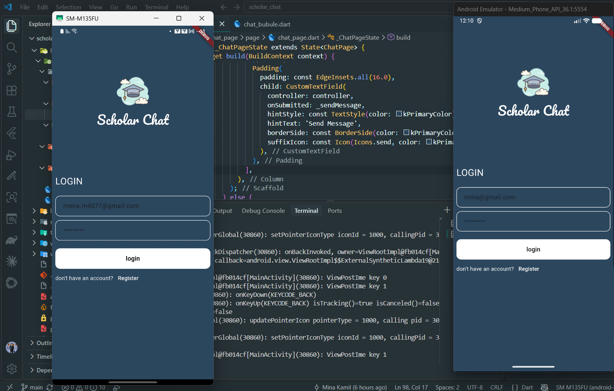
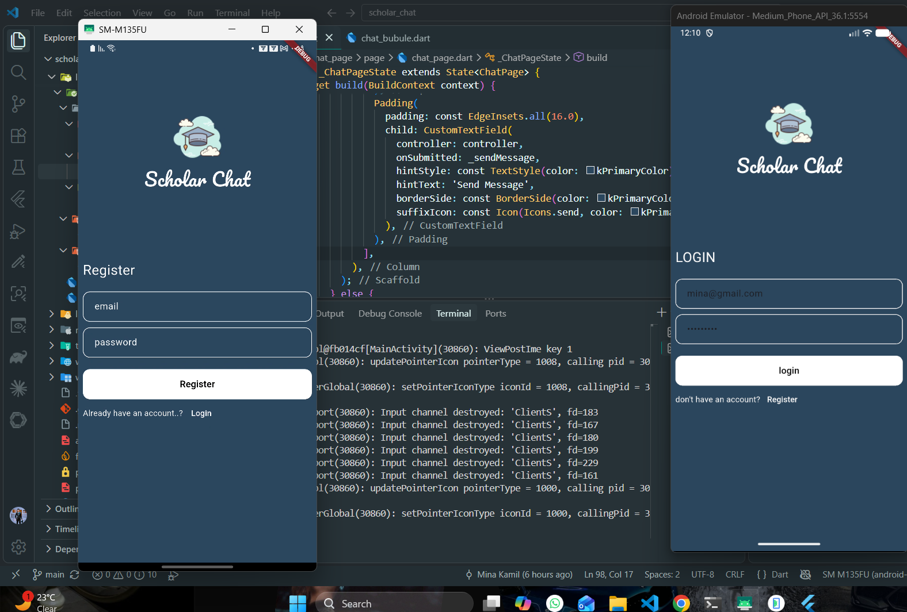
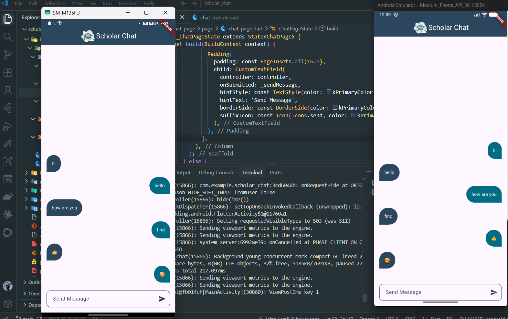

# Scholar Chat

Scholar Chat is a Flutter messaging app with email and password authentication and a real-time chat powered by Firebase. Signed-in users can send messages and see messages from other users, with separate styles for their own messages and messages from others.

## App preview

### Screenshots

| Login | Register | Chat |
|---|---|---|
|  |  |  |

### Demo video

[Watch the Scholar Chat demo](docs/screenshots/demo.mp4)

## Features

- Register and sign in with Firebase Authentication using email and password.
- Validate email and password fields on the login and registration screens.
- Exchange chat messages through Cloud Firestore and receive live updates.
- Show the sender's messages and other users' messages with different chat bubble styles.
- Store each message's text, creation time, and sender email.
- Clear the message field after sending and ignore empty messages.
- Reusable form fields, buttons, navigation helpers, and styled status snackbars.

## Tech stack

- Flutter and Dart
- Firebase Authentication
- Cloud Firestore

## Packages

| Package | Version constraint | Purpose |
|---|---:|---|
| `firebase_core` | `^4.15.0` | Initialize Firebase for the app. |
| `firebase_auth` | `^6.7.0` | Email and password registration and sign-in. |
| `cloud_firestore` | `^6.10.0` | Store and stream chat messages. |
| `conditional_builder_null_safety` | `^0.0.6` | Conditional widget builder utility (declared dependency). |
| `cupertino_icons` | `^1.0.8` | Cupertino icon set. |
| `flutter_lints` | `^6.0.0` | Dart and Flutter lint rules for development. |
| `flutter_test` | Flutter SDK | Flutter testing framework (development dependency). |

## Requirements

- Flutter SDK and Dart SDK versions compatible with `pubspec.yaml` (`sdk: ^3.12.2`).
- A Firebase project with **Email/Password** sign-in enabled in Firebase Authentication and Cloud Firestore created.
- Android Studio, VS Code, or another Flutter-compatible editor, plus an emulator or device.

## Getting started

1. Clone the repository and open its directory:

   ```bash
   git clone <https://github.com/Mina8496/scholar_chat>
   cd scholar_chat
   ```

2. Install dependencies:

   ```bash
   flutter pub get
   ```

3. Connect the app to your Firebase project. The repository includes `lib/firebase_options.dart` and an Android `google-services.json`; if you are using your own Firebase project, regenerate the configuration with the FlutterFire CLI:

   ```bash
   dart pub global activate flutterfire_cli
   flutterfire configure
   ```

   Select the platforms you intend to run. Keep the generated `lib/firebase_options.dart` and native Firebase configuration files in sync with the same Firebase project.

4. In the Firebase console, enable **Email/Password** under Authentication sign-in providers and create a Cloud Firestore database. Configure Firestore security rules to allow only authenticated users to read and write chat messages; do not use open test-mode rules in a deployed app.

5. Run the app on a supported configured device:

   ```bash
   flutter run
   ```

Firebase options are configured for Android, iOS, and Windows in the current `lib/firebase_options.dart`. Other platforms need to be configured with FlutterFire before use. Platform support also depends on the Firebase plugins and native project setup.

## Firestore message format

Messages are stored as documents in the `messages` collection:

```text
messages/{documentId}
  message:   String    // message text
  createdAt: Timestamp // server creation time
  id:        String    // sender email
```

The chat stream orders documents by `createdAt` and updates the conversation as Firestore changes.

## Project structure

```text
lib/
+-- core/
|   +-- constants.dart          # Shared colors, asset paths, and Firestore keys
|   +-- helper/                 # Snackbar helpers
|   +-- routes/                 # Navigation helpers
|   +-- widgets/                # Shared buttons and text fields
+-- feature/
|   +-- chat_page/
|   |   +-- model/              # Message model
|   |   +-- page/               # Real-time chat screen
|   |   +-- widget/             # Chat bubbles
|   +-- login/page/             # Login screen
|   +-- register/page/          # Registration screen
+-- firebase_options.dart      # FlutterFire platform configuration
+-- main.dart                  # Firebase initialization and app entry point
```

## Assets

- App logo: `assets/images/scholar.png`
- Pacifico font: `assets/fonts/Pacifico-Regular.ttf`

## License

No license has been added yet.
